<div align="center">

# Ctrl+Alt+Steal

**A live, multiplayer AI-heist game for college events.**<br>Crews play on their phones, the projector runs the show, and organisers steer everything from one control room.

<p>
  <a href="LICENSE"></a>
  
  
  
  
</p>

Built by [Darshan Pawar](https://github.com/Darshanpawar7) for **Neural Hive**, PES University, and first run in October 2026.

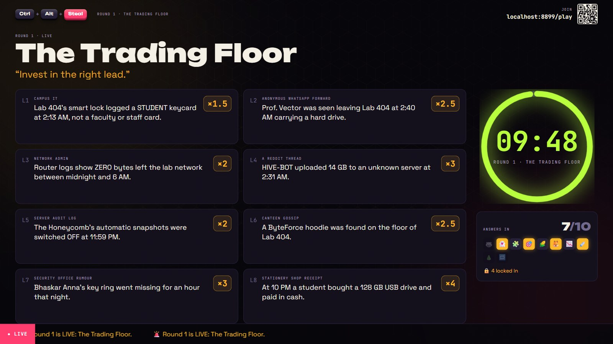

</div>

## Contents

- [Overview](#overview)
- [Features](#features)
- [Gallery](#gallery)
- [How the game works](#how-the-game-works)
- [Quick start](#quick-start)
- [Deployment](#deployment)
- [Configuration](#configuration)
- [Running your own event](#running-your-own-event)
- [Architecture](#architecture)
- [Development](#development)
- [Documentation](#documentation)
- [Contributing](#contributing)
- [Author](#author)
- [Licence](#licence)

## Overview

Neural Hive's prize AI model has been stolen. Crews of three or four "recovery agents" race through four rounds, earning and betting Compute Credits, collecting clues and spotting AI fakes, before staking everything on naming the thief.

Ctrl+Alt+Steal is the complete platform behind that event. It has five parts, all served from one address:

| Page | Used by | Purpose |
| --- | --- | --- |
| `/` | Everyone | Landing page with the story, rounds, schedule and FAQ |
| `/register` | Crews, before the event | Sign up and receive a 6-character team code |
| `/play` | Crews, on their phones | The agent console: every round, timers, clues and a shared deduction board |
| `/screen` | The projector | A big-screen display for every moment of the event, with sound |
| `/admin` | Organisers and volunteers | Run of show, check-in, answers, scores, content, backups and a print kit |

Everything stays in sync over WebSockets: when the host presses **Next**, the projector and every phone change at the same moment.

<table>
  <tr>
    <td rowspan="2" width="27%" valign="top">
      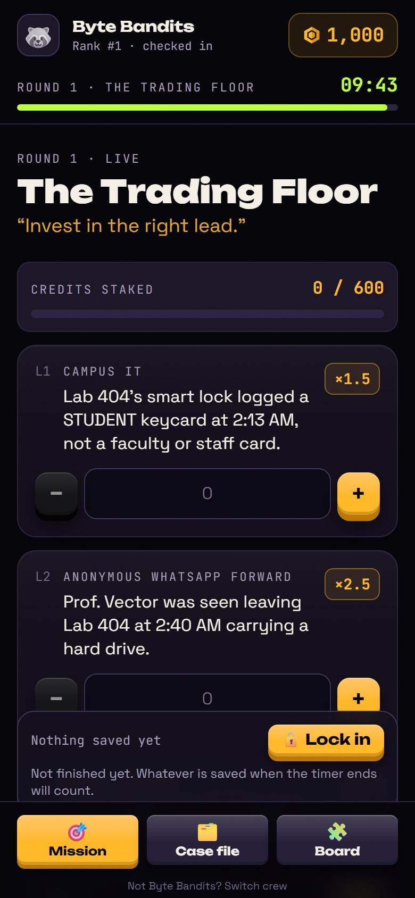
      <br><sub><b>Phone</b>: the agent console</sub>
    </td>
    <td>
      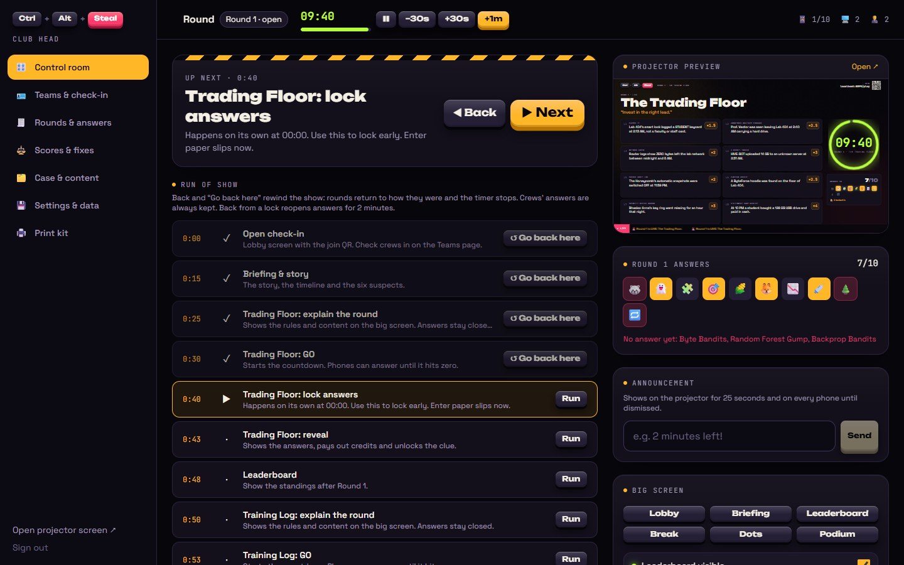
      <br><sub><b>Control room</b>: run of show, timers and live answer tracking</sub>
    </td>
  </tr>
  <tr>
    <td>
      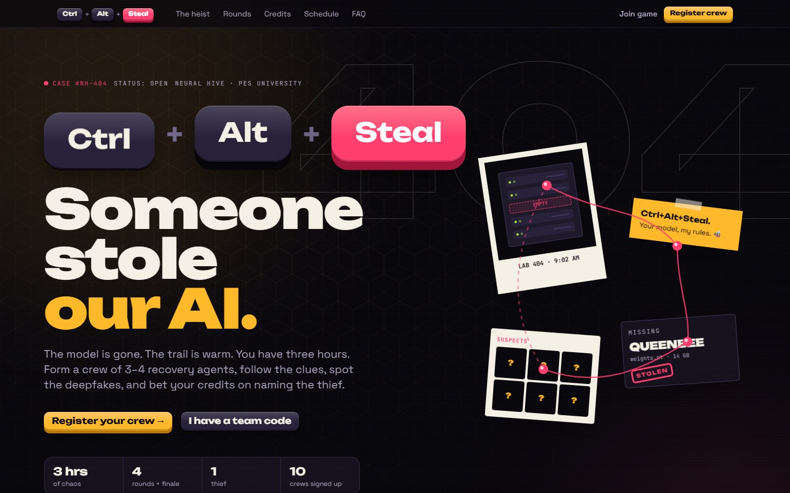
      <br><sub><b>Landing page</b>: the story, the rounds and registration</sub>
    </td>
  </tr>
</table>

## Features

### For players

- Join by code or QR; every teammate can play on their own device
- Answers save automatically and lock at 00:00, so nothing needs collecting
- Clues gather in a case file, and a shared deduction board keeps the whole crew involved
- Phones reconnect by themselves after a dropped signal or a server restart

### On the big screen

- A dedicated view for every moment: lobby with join QR, briefing, each round, the vault doors, a step-by-step final reveal and a podium with badges
- Live countdowns, a ticker of crew activity and synthesised sound effects

### For organisers

- A control room with the whole run of show: **▶ Next**, **◀ Back**, and **Go back here** to rewind to any step
- Timer controls (pause, ±30 s, +1 min, which also reopens a closed round)
- Check-in desk, walk-in crews, paper-slip entry and a print kit with QR code cards
- Credits recalculated from answers every time, so fixing an answer or a key updates every total; manual adjustments need a written reason
- An audit log of every staff action, CSV exports, and full backups and restores
- The entire mystery, every round, the payouts and the answer keys are editable in the browser
- Two roles: club heads have full control; desk volunteers handle check-in and paper slips and never see answers

### Fair play and resilience

- Answer keys never leave the server before their reveal, and each role receives only its own view
- Round 3 photos are stripped of hidden details (camera, GPS, "made with AI" labels), re-encoded uniformly and protected against easy saving
- Rate limits, timing-safe password checks, a Content Security Policy and an origin allow-list
- State is saved to Postgres continuously and survives restarts; one laptop can run the event offline as a fallback
- Load-tested with 40 crews on 120 phones at 2–5% of one CPU core

## Gallery

The big moments, as the room sees them on the projector:

<table>
  <tr>
    <td width="50%">
      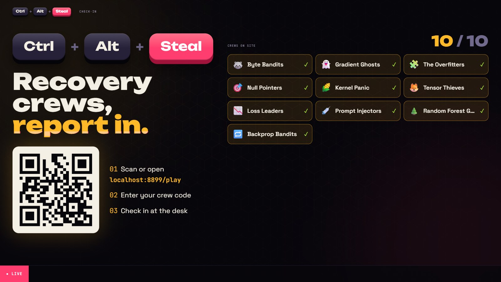
      <br><sub><b>Check-in</b>: crews join by QR and light up as they arrive</sub>
    </td>
    <td width="50%">
      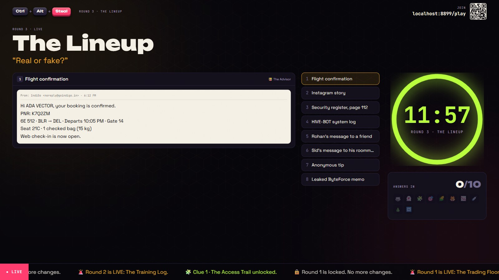
      <br><sub><b>Round 3</b>: real evidence or an AI fake?</sub>
    </td>
  </tr>
  <tr>
    <td>
      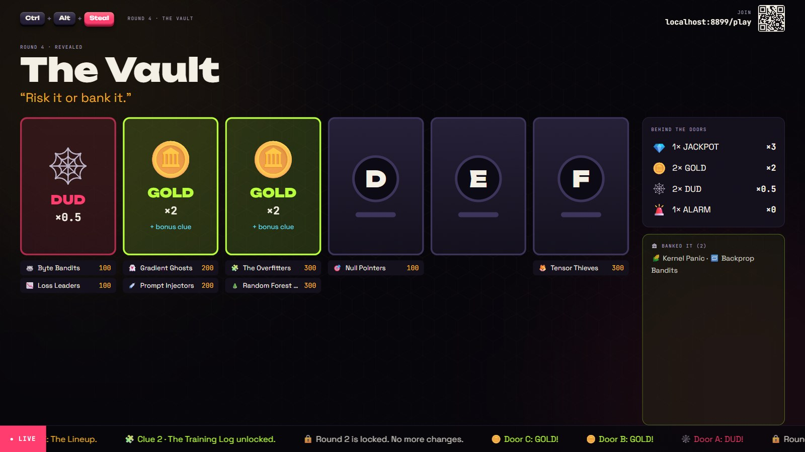
      <br><sub><b>The vault</b>: doors open one by one, with every crew's wager on show</sub>
    </td>
    <td>
      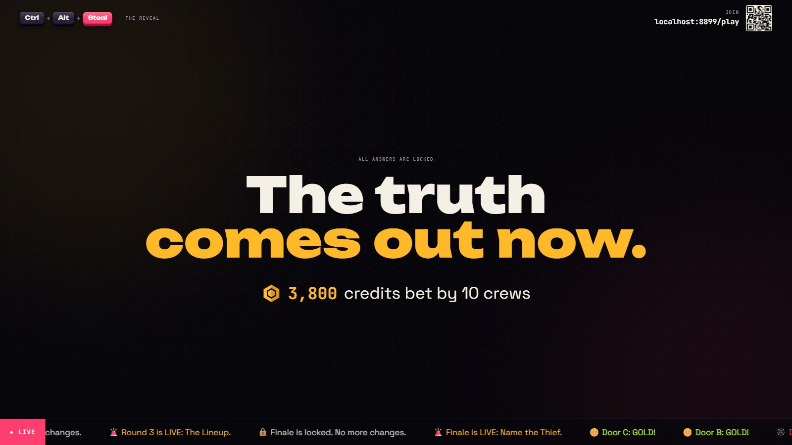
      <br><sub><b>The reveal</b>: a step-by-step finale with drumrolls</sub>
    </td>
  </tr>
  <tr>
    <td colspan="2">
      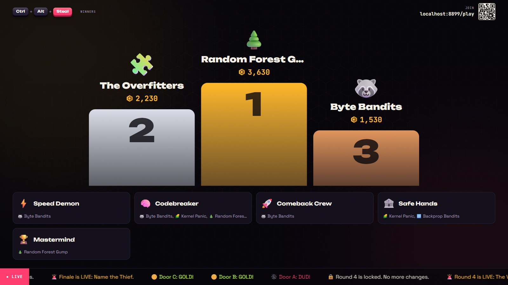
      <br><sub><b>Podium</b>: the top three, plus a badge wall so more crews get a moment</sub>
    </td>
  </tr>
</table>

And on every crew's phone:

<table>
  <tr>
    <td width="33%">
      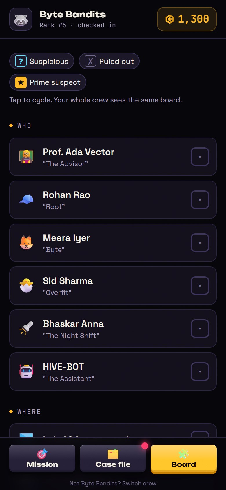
      <br><sub><b>Deduction board</b>, shared by the whole crew</sub>
    </td>
    <td width="33%">
      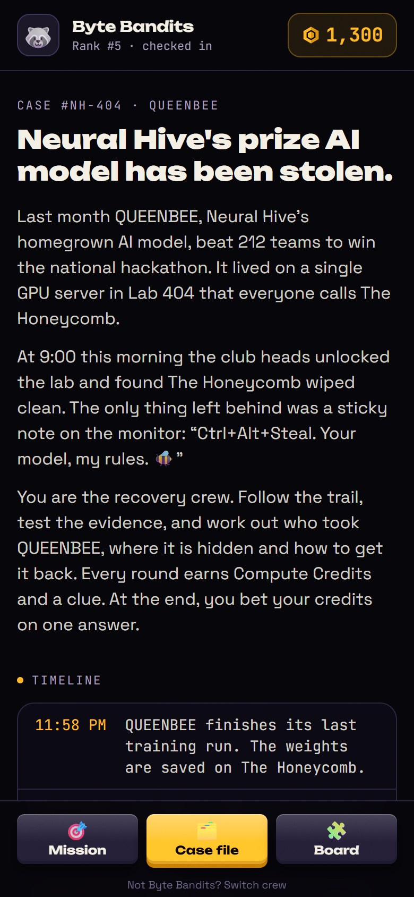
      <br><sub><b>Case file</b> with the story and every clue</sub>
    </td>
    <td width="33%">
      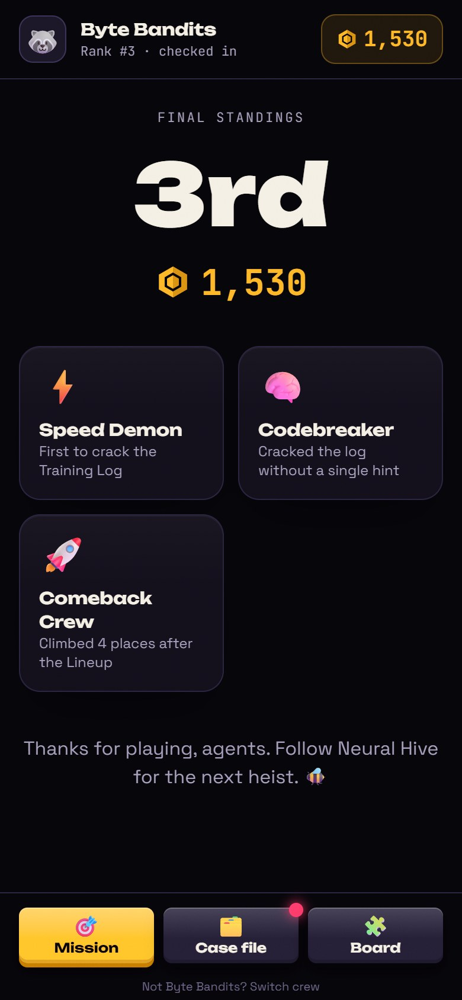
      <br><sub><b>Final result</b> and badges</sub>
    </td>
  </tr>
</table>

## How the game works

Every crew starts with **1,000 Compute Credits**. The crew with the most credits after the final bet wins.

| Round | Time | What crews do | Scoring |
| --- | --- | --- | --- |
| **1 · The Trading Floor** | 10 min | Stake up to 600 credits across eight leads, some real and some rumours | A real lead pays its stake × its odds (×1.5 to ×4); a rumour loses its stake |
| **2 · The Training Log** | 15 min | Decode a corrupted training log to answer three questions | +100 / +150 / +200; hints cost 75–100; the first three all-correct crews to lock in earn +150 / +100 / +50 |
| **3 · The Lineup** | 12 min | Mark each piece of evidence as real or AI-generated | +80 per correct call, −40 per wrong call |
| **4 · The Vault** | 7 min | Bank credits, or pick one of six doors and wager | Doors pay ×3, ×2, ×0.5 or ×0, opened one by one on the big screen; winning doors reveal a bonus clue |
| **Finale · Name the Thief** | 8 min | Name the thief, the hideout and the recovery method, and bet | 3 of 3 correct pays ×3, 2 of 3 returns the bet, fewer loses it |

Every number is configurable. The full rules, run of show and organiser checklists are in the [event guide](docs/EVENT-GUIDE.md).

## Quick start

**Requirements:** Node.js 22.12 or later.

```bash
git clone https://github.com/Darshanpawar7/Ctrl-Alt-Steal-NH.git
cd Ctrl-Alt-Steal-NH
npm install
cp .env.example .env    # sets local admin and volunteer passwords
npm run dev
```

This starts the game server on port 8787 and the website on <http://localhost:5173>. Open:

| URL | What you'll see |
| --- | --- |
| <http://localhost:5173> | The landing page |
| <http://localhost:5173/screen> | The projector view (click once to start) |
| <http://localhost:5173/admin> | The control room; sign in with `change-me-admin` from `.env` |
| <http://localhost:5173/play> | The phone view; use a team code from the admin's Teams page |

To try a full game alone, open **Settings & data → Add demo crews** in the admin, then step through the show with **▶ Next**. Without `DATABASE_URL`, the game is saved to the `.data/` folder.

## Deployment

The project is designed to run on free plans:

1. **[Supabase](https://supabase.com)** (or Neon) provides the Postgres database.
2. **[Render](https://render.com)** runs the website and game server as one service, configured by [`render.yaml`](render.yaml). Deploy with **New → Blueprint**.
3. **[UptimeRobot](https://uptimerobot.com)** pings `/api/health` every 5 minutes so the free server never sleeps.

The step-by-step guide, free-plan limits, measured performance, an on-the-day checklist and an offline fallback are in **[docs/DEPLOYMENT.md](docs/DEPLOYMENT.md)**. To run everything from one laptop on the venue Wi-Fi instead, use `npm run laptop`.

## Configuration

Set these in `.env` locally, or in your host's environment settings:

| Variable | Default | Description |
| --- | --- | --- |
| `ADMIN_PASSWORD` | *(none)* | **Required.** Password for club heads, who have full control |
| `VOLUNTEER_PASSWORD` | *(none)* | Password for desk volunteers. Without it, volunteer sign-in is disabled |
| `DATABASE_URL` | *(none)* | Postgres connection string. Without it, the game is saved to `DATA_DIR` |
| `DATABASE_CA_CERT` | *(none)* | CA certificate for full TLS verification of the database |
| `PG_POOL_MAX` | `4` | Maximum database connections |
| `ALLOWED_ORIGINS` | the Render address | Extra website origins allowed to call the server, comma-separated |
| `DATA_DIR` | `.data` | Save folder when no database is configured |
| `PORT` | `8787` | HTTP port (set automatically on Render) |
| `SERVE_CLIENT` | `true` | Set to `false` to serve the API only |
| `VITE_API_URL` | same origin | *Build time.* The game server's address when the website is hosted separately |

## Running your own event

- **Write your own mystery.** This repository is public, so the default case's answers are too (see `src/server/game/content.ts` and [the host answer key](docs/HOST-ANSWER-KEY.md)). Change the story, suspects, clues, rounds and answer keys in **Admin → Case & content** before registration opens. Those edits are saved in the database, not the code, so they stay private.
- **Set the event details** (date, venue, social links, registration open or closed) in **Admin → Settings & data**.
- **Rehearse** with demo crews and the load test, then press **Reset after dry run** to clear answers and check-ins while keeping crews and content.
- **Brief your team** with the [event guide](docs/EVENT-GUIDE.md): roles, the run of show, checklists and troubleshooting.

## Architecture

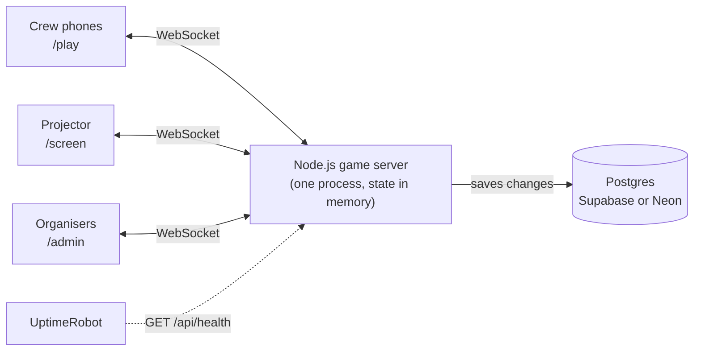

One Node.js process holds the entire event in memory.

- **Actions:** every action from a phone or the admin is validated and applied by a pure reducer (built on Immer, so only changed parts are copied), then queued for saving.
- **Scoring:** credits are never stored. They are derived from answers and answer keys on demand, which is why corrections are instant and consistent.
- **Views:** each connection receives only the view its role is allowed to see, and after the first full view only the sections that changed, batched every 100 ms.
- **Saving:** writes to Postgres are coalesced and retried with backoff. On start-up the server refuses to run until the saved game has loaded, so an empty game can never overwrite a real one. A clean shutdown flushes everything before a restart.

**Tech stack:** React 19, Vite, Tailwind CSS 4 and Motion on the client; Node.js 22, `ws`, `pg` and Immer on the server; TypeScript throughout; Vitest with PGlite for tests.

```text
src/
  shared/        types and the wire protocol (safe for the browser: no answers)
  server/        HTTP and WebSocket app, game room, storage, image cleaning
    game/        the engine: actions, scoring, per-role views, default content
  client/        React app
    pages/       landing, register, play (phones), screen (projector), admin
    components/  shared UI, round forms, evidence cards, timers, leaderboard
scripts/         dev runner, load test, database check, profiler
test/            Vitest suites
docs/            event guide, deployment guide, host answer key
```

## Development

| Command | Description |
| --- | --- |
| `npm run dev` | Game server and website with live reload |
| `npm test` | Run the test suite |
| `npm run typecheck` | Type-check the client and the server |
| `npm run build` | Build the website into `dist/` |
| `npm run build:server` | Build the server into `dist-server/` |
| `npm start` | Run the production build |
| `npm run laptop` | Build everything and run it locally (the offline fallback) |
| `npm run load-test -- <url> <admin-password>` | Simulate a full hall against a running server |

The test suite covers the game engine and scoring, per-role views (answer keys must never leak), the live HTTP and WebSocket server, a real Postgres store (in-process with PGlite), restarts, photo cleaning, and the run of show. One property test rewinds from every step of the event to every earlier step and checks the game lands exactly there.

## Documentation

| Document | Contents |
| --- | --- |
| [Event guide](docs/EVENT-GUIDE.md) | Rules and payouts, the run of show, roles, checklists, troubleshooting |
| [Deployment guide](docs/DEPLOYMENT.md) | Free hosting step by step, limits, on-the-day checklist, offline fallback |
| [Host answer key](docs/HOST-ANSWER-KEY.md) | The default case's solution and host script. **Spoilers.** |

## Contributing

Issues and pull requests are welcome. Before opening a pull request, make sure `npm test` and `npm run typecheck` pass, and keep each change focused on one thing.

## Author

Created by **Darshan Pawar** for Neural Hive, PES University.

- GitHub: [@Darshanpawar7](https://github.com/Darshanpawar7)
- Email: [darshanpawar006@gmail.com](mailto:darshanpawar006@gmail.com)

## Licence

Released under the [MIT licence](LICENSE). Use it, adapt it and run your own events with it; a credit to Neural Hive, PES University is appreciated.
